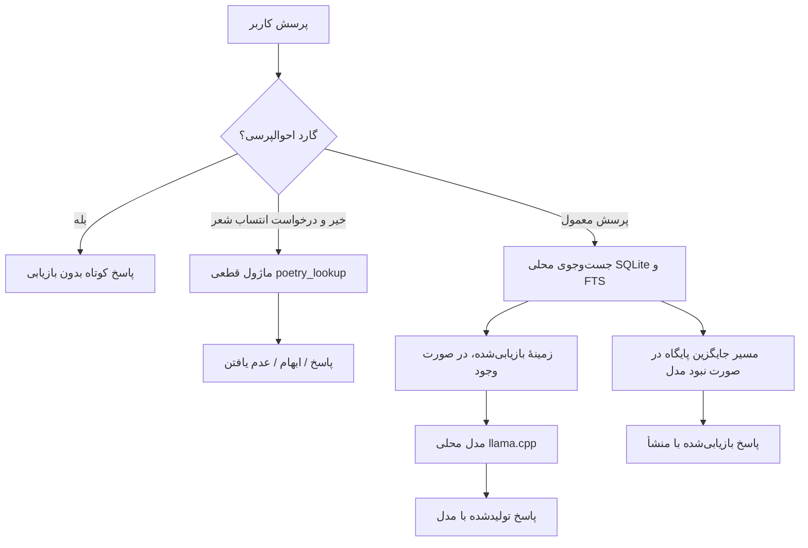

# سیمرغ: مطالعهٔ موردی یک دستیار هوش مصنوعی فارسی، آفلاین و منبع‌محور روی سخت‌افزار مصرفی

> **پیش‌نویس مقالهٔ کامل برای همایش ملی «آینده فضای مجازی ایران در عصر هوش مصنوعی»** (محور: زیرساخت، فناوری و استقلال فناورانه؛ مهلت ارسال ۳۰ دی ۱۴۰۵).
> اعداد نتایج شعر در گزارش‌های تاریخی `docs/evidence/` ثبت شده‌اند؛ آن‌ها نتایج بنچمارک جدید ۴۰ پرسشی نیستند. بنچمارک جدید `eval/questions_paper_v1.json` هنوز اجرا نشده است.
> پیش از ارسال: متن کامل فراخوان و قالب رسمی از دبیرخانه گرفته شود؛ صفحهٔ رسمی پیوندشده در زمان بررسی قابل‌خواندن نبود. ارجاعات `[ارجاع]` را پس از مطالعهٔ منبع پر کن و نام نویسنده/وابستگی را اضافه کن.

## چکیده
متن چکیده در `docs/paper/ABSTRACT.md` است و باید با اعداد نهایی این متن هم‌خوان بماند.

## ۱. مقدمه
استفاده از هوش مصنوعی مولد در خدمات فارسی‌زبان، پرسش‌هایی دربارهٔ دسترسی به شواهد، ارزیابی در زبان فارسی و استقلال زیرساختی ایجاد می‌کند. بنچمارک‌های فارسی پیشین، وظایف دانشی و فرهنگی متنوعی را بررسی کرده‌اند و بر نیاز به ارزیابی ثابت و قابل‌ردیابی تأکید دارند (Abaskohi et al., 2024; Hosseinbeigi et al., 2025). این مقاله ادعای جامع‌بودن ندارد و تنها یک مسیر محدودِ بازیابی/انتساب شعر را با خروجی‌های قابل‌ردیابی بررسی می‌کند.

این مقاله سیمرغ را مطالعهٔ موردیِ یک دستیار فارسی با مسیرهای اجرای محلی و بازیابی از منابع بررسی می‌کند. باید دو مسیر را از هم جدا کرد: ماژول مشخص انتساب بیت به شاعر می‌تواند برای برخی پرسش‌ها پاسخ قطعی را مستقیماً از پایگاه برگرداند؛ اما در پرسش‌های معمول شعر، قرآن و کتاب، نتایج بازیابی‌شده عموماً به زمینهٔ ورودی مدل افزوده می‌شوند و پاسخ نهایی ممکن است تولید مدل باشد. در نبود مدل، مسیر جایگزین پایگاه می‌تواند نتایج بازیابی‌شده را مستقیم نمایش دهد. سهم مقاله محدود است: (۱) توصیف این مرز معماری؛ (۲) ارزیابی تاریخیِ انتساب شعر با نمونه‌های مستقل، بازهٔ اطمینان و تحلیل خطا؛ (۳) مقایسه با همان مدل بدون بازیابی؛ (۴) سه توصیهٔ سیاستی مشروط به محدودیت شواهد.

## ۲. سامانه
**مسیر اجرای مورد مطالعه.** در اجرای تاریخی ثبت‌شده، مدل Gemma-3-4B با کوانتیزاسیون ۴بیتی از طریق llama.cpp و پایگاه‌های SQLite/FTS روی رایانه‌ای با پردازندهٔ Intel Core i5-4460، حدود ۷٫۷ گیگابایت حافظه و بدون GPU استفاده شده‌اند. این سابقه، اثبات اجرای کامل سناریوی پنج‌دقیقه‌ای آفلاین در وضعیت کنونی نیست؛ آن سناریو هنوز اندازه‌گیری نشده است.

**داده‌ها و دسترسی.** گزارش‌های ارزیابی پیشین از مجموعهٔ شعر محلی با ۱٬۴۰۶٬۹۱۹ رکورد و پایگاه قرآنی با ۶٬۲۳۶ ردیف استفاده کرده‌اند. بااین‌حال، مسیر پیش‌فرض `data/poetry/persian_poetry.db` که ماژول انتساب شعر می‌خواند در درخت عمومی فعلی مشاهده نشد؛ بنابراین بازتولید این آزمون از clone تازه تأیید نشده است. منبع ترجمهٔ پایگاه قرآنی در رجیستر حقوقی به Tanzil `fa.ansarian` نسبت داده شده، اما تطبیق دقیق فایل و مجوز بازتوزیع همچنان `NOT_VERIFIED` است؛ حقوق مجموعه/لایهٔ گردآوری شعر نیز روشن نشده است.

**مرز منشأ.** پاسخ قطعیِ مسیر انتساب شعر می‌تواند بدون فراخوانی مدل بازگردد. در مسیر عادی، نتایج قرآن/شعر/کتاب معمولاً زمینهٔ ورودی مدل می‌شوند؛ نباید همهٔ پاسخ‌های منبع‌دار را «بدون دخالت مدل» معرفی کرد. در حالت بی‌دسترسی به مدل، تابع جایگزین پایگاه می‌تواند متن بازیابی‌شده را مستقیم و با برچسب منبع نمایش دهد.

**جایگاه در پژوهش‌های پیشین.** روش‌های بازیابی‌افزوده، خروجی مدل را با حافظه/منبع بیرونی شرطی می‌کنند (Lewis et al., 2020). کارهای ارزیابی زبان فارسی مانند Abaskohi et al. (2024) و Hosseinbeigi et al. (2025) مجموعه‌های گسترده‌تری را پوشش می‌دهند؛ بنچمارک ۴۰ پرسشی سیمرغ کوچک‌تر و وظیفه‌محور است و جایگزین آن‌ها نیست. برای ادبیات فارسی، Raji et al. (2024) پیکره‌ای ادبی با فرادادهٔ سبک و دوره معرفی کرده‌اند و Shahnazari et al. (2025، پیش‌چاپ) به انتساب مؤلف شعر با روش نظارت‌شده پرداخته‌اند. این وظایف با جست‌وجوی عبارت و خودداری در ماژول سیمرغ مستقیماً قابل‌مقایسه نیستند. نسبت پوشش و خطای مسیرِ خودداری نیز با ادبیات selective classification مرتبط است (Geifman and El-Yaniv, 2017)، اما سیمرغ ریسک را کالیبره نمی‌کند و تضمین رسمیِ نرخ خطا نمی‌دهد.

**شکل ۱. مسیرهای معماری در پیاده‌سازی بررسی‌شده (طرح کدی، نه تضمین عملکرد).**



این شکل مرز مفهومی را نشان می‌دهد: انتساب قطعی شعر، بازیابی زمینه برای مدل و پاسخ جایگزین در نبود مدل، یک مسیر واحد نیستند. شکل تضمین نمی‌کند که مدل در هر پرسش عادی، در نبود شاهد کافی، حتماً خودداری کند.


## ۳. روش: نسبت‌دهی بیت به شاعر
پرسش «این بیت از کیست؟» با یک الگوریتم قطعی پاسخ داده می‌شود:
۱. نرمال‌سازی (یکسان‌سازی ی/ک عربی و فارسی، حذف اعراب) و واژه‌بندی.
۲. **مرحلهٔ عبارت:** جستجوی عبارت دقیق (تا ۶ واژه) در نمایهٔ FTS5 با واکشی ۹ نتیجه. اگر نتایج به یک شاعر برسد و پرسش دست‌کم ۴ واژه باشد، پاسخ داده می‌شود؛ اگر چند شاعر باشند، «مبهم» است.
۳. **مرحلهٔ جایگزین:** جستجوی OR روی واژه‌های محتوایی؛ فقط وقتی پاسخ می‌دهد که هم‌پوشانی واژگانی دست‌کم ۰٫۸ و دست‌کم دو نتیجهٔ برتر هم‌رأی باشند. در غیر این صورت «نامطمئن» با فهرست کاندیدا.
۴. **قاعدهٔ پنجرهٔ پر:** اگر تعداد نتایج عبارت از سقف واکشی بیشتر باشد، عبارت بیش از حد رایج است و حتی با یک شاعر در نتایج دیده‌شده، به او نسبت داده نمی‌شود. این قاعده از یافته‌ای در ارزیابی (بخش ۵٫۳) برآمده است.

## ۴. روش ارزیابی
پرسش‌ها از خود پایگاه ساخته می‌شوند (حالت «آسان»)، پس ارزیابی رفتار بازیابی و خودداری را می‌سنجد، نه درستی روی ورودی دلخواه کاربر؛ و درستی نسبت به نسبت‌دهی خود پایگاه سنجیده می‌شود. حالت‌ها: ۶ واژهٔ ابتدایی؛ ۴ واژه از وسط بیت؛ سه نوع خطای املایی (حذف حرف آخر یک واژه، حذف حرف میانی، جابه‌جایی دو حرف مجاور)؛ و **بیت ترکیبی ساختگی** (۳ واژه از یک بیت و ۳ واژه از بیت شاعری دیگر) برای سنجش پذیرش اشتباه. نمونه‌ی توسعه (seed ۷) جدا از سه نمونه‌ی مستقل (seed ۱۱ و ۲۳ و ۳۷، هر کدام ۳۰۰ بیت؛ مجموع ۹۰۰) گزارش می‌شود و بازه‌های اطمینان ۹۵٪ از روش ویلسون محاسبه شده‌اند. از آنجا که پایگاه برخی ابیات را برای چند شاعر ثبت کرده (مثلاً نقل‌قول)، حقیقت مبنا برای چنین بیتی مجموعهٔ شاعران است؛ این اصلاح پس از بررسی خطاها انجام شد و شمارش سخت‌گیرانه هم نگه داشته شده است.

## ۵. نتایج
### ۵٫۱ نسبت‌دهی بیت (نمونه‌های مستقل، n = ۹۰۰)

| حالت پرسش | پاسخ‌داده‌شده | درستی پاسخ‌ها |
|---|---|---|
| ۶ واژهٔ ابتدایی | ۸۹۶ از ۹۰۰ (۹۹٫۶٪) | ۸۹۶ از ۸۹۶ (حد پایین ۹۹٫۶٪) |
| ۴ واژه از وسط | ۸۶۴ از ۹۰۰ (۹۶٫۰٪) | ۸۶۴ از ۸۶۴ (حد پایین ۹۹٫۶٪) |
| حذف حرف آخر یک واژه | ۲۹۹ از ۹۰۰ (۳۳٫۲٪) | ۲۹۹ از ۲۹۹ |
| حذف حرف میانی | ۲۹۷ از ۹۰۰ (۳۳٫۰٪) | ۲۹۷ از ۲۹۷ |
| جابه‌جایی دو حرف مجاور | ۳۰۳ از ۹۰۰ (۳۳٫۷٪) | ۳۰۳ از ۳۰۳ |
| بیت ترکیبی پذیرفته‌شده | ۱ از ۴۱۶ (۰٫۲٪؛ حد بالا ۱٫۳٪) | — |

در هر سه حالت املایی یک مورد بیتی بود که پایگاه آن را برای دو شاعر ثبت کرده و سیستم یکی از دو را برگرداند. تنها بیت ترکیبیِ پذیرفته‌شده، شاعری را برگرداند که یکی از دو منبع ترکیب بود.

### ۵٫۲ مقایسه با مدل تنها
روی همان نمونه‌ها و همان پرسش شش‌واژه‌ای، Gemma-3-4B بدون بازیابی روی ۳۰۰ بیت (سه نمونه‌ی مستقل، هر کدام ۱۰۰) فقط **۲۹ پاسخ درست داد (۹٫۷٪، بازهٔ ۶٫۸ تا ۱۳٫۵)**، هیچ‌بار «نمی‌دانم» نگفت و ۲۷۱ پاسخ نادرست داد. سیستم بازیابی ۲۹۹ از ۳۰۰ پرسش را پاسخ داد و هر ۲۹۹ مورد درست بود. تطبیق نام شاعر عمداً به نفع مدل سهل‌گیرانه بود. در پایلوت کوچک پرسش‌وپاسخ شخصی (۸ پرسش) مدل ۳ پاسخ درست، ۱ «نمی‌دانم» و ۴ پاسخ غلط داد و در طبقه‌بندی ۱۰ گزارش شهری ۹ مورد درست بود؛ این اعداد برای ادعای کلی بسیار کم‌اند.

### ۵٫۳ نقصی که ارزیابی آشکار کرد
در اجرای نخست، عبارت «و روشن دل و» (از نظامی) به فردوسی نسبت داده شد، چون هر هشت نتیجهٔ اول عبارتی رایج در شاهنامه بودند و سیستم پنجرهٔ پر را نشانهٔ یکتا بودن گرفت. با قاعدهٔ «پنجرهٔ پر» (بخش ۳) اصلاح شد و روی سه نمونهٔ مستقل، همهٔ ۸۶۴ پاسخِ حالت چهارواژه‌ای درست بود. این نمونه نشان می‌دهد چرا ارزیابی مستقل از نمونه‌ی توسعه لازم است.

## ۶. بحث و محدودیت‌ها
- **پوشش در برابر خطای املایی** در گزارش تاریخی حدود یک‌سوم بود. سیستم به‌جای حدس خودداری کرد؛ در نمونه‌های گزارش‌شده، در بسیاری از موارد خودداری شاعر درست در فهرست کاندیداها بود. این رفتار، پوشش کم روی ورودی دارای غلط را رفع نمی‌کند.
- پرسش‌های انتساب از خود پایگاه ساخته شده بودند؛ این شرط آسان‌تر از ورودی آزاد کاربر است و درستی نسبت به داده و انتساب‌های همان پایگاه سنجیده می‌شود. ارزیابی انسانی یا کاربرپژوهی انجام نشده است.
- اعداد QA و طبقه‌بندی قبلی روی نمونه‌های کوچک، برای ادعای عمومی کافی نیستند. بنچمارک ۴۰ پرسشی و چهار اجرای مقایسه‌ای در شاخهٔ پژوهشی آماده شده‌اند اما **هنوز اندازه‌گیری نشده‌اند**؛ در نتیجه در این پیش‌نویس نتایجی برای آن‌ها گزارش نمی‌شود.
- اجرای پیشین روی یک دستگاه و یک پیکربندی مدل بوده است. تعمیم به مدل‌ها، سخت‌افزارها یا زبان‌های دیگر آزموده نشده است.
- مسیر دادهٔ شعر موردنیاز از clone تازه تأیید نشده و وضعیت حقوق/مجوز بازتوزیع شعر و ترجمهٔ فارسی قرآن همچنان حل‌نشده است. تا رفع آن، نباید ادعای بازتولیدپذیری کامل یا مجازبودن بازتوزیع کرد.
- «انتخاب کاربر»، «ممنوعیت خودتغییری» و تفکیک ادعا از تأیید در منشور، اصول طراحی‌اند؛ اثرگذاری آن‌ها در این آزمایش‌ها اندازه‌گیری نشده است.

## ۷. سناریوی کاربردی مستقل: دسته‌بندی گزارش شهروندی در یزد (طرح مفهومی، نه استقرار میدانی)

در یک سناریوی مفهومی برای دریافت گزارش‌های شهری در یزد، می‌توان متن فارسی شهروند را به یکی از پنج دستهٔ «آب»، «خیابان»، «روشنایی»، «زباله» یا «سایر» ارجاع داد تا کارمند انسانی گزارش را مرور و اولویت‌بندی کند. این سناریو **ادعای اتصال سیمرغ به شهرداری، استقرار در یزد یا پردازش دادهٔ واقعی شهروندان نیست**. گزارش ارزیابی قبلی مخزن، روی ۱۰ نمونهٔ کوتاه و آسانِ طبقه‌بندی، ۹ پاسخ درست ثبت کرده است؛ این نمونه نه تصادفی بود و نه از گزارش‌های میدانی جمع‌آوری شده و برای برآورد عملکرد در عملیات شهری کافی نیست. بنچمارک ۴۰ موردی جدید نیز در این مرحله هنوز اجرا نشده است. در چنین کاربردی خروجی مدل باید پیشنهاد اولیه باشد و تصمیم نهایی را انسان بگیرد.


## ۸. توصیه‌های سیاستی
سه توصیهٔ مشروط به شواهد در `docs/paper/POLICY_RECOMMENDATIONS_FA.md` آمده‌اند: (۱) پاسخ بازیابی‌شده از پاسخ تولیدشده تفکیک و رفتار خودداری اندازه‌گیری شود؛ (۲) پایگاه‌های فرهنگی با نسخه، هش، منشأ، حقوق روشن و فرادادهٔ انتساب چندگانه نگهداری شوند؛ (۳) تدارک/استقرار سامانه‌های فارسی به آزمون مستقل با baseline مدل‌تنها، بازیابی روشن/خاموش، میزان خودداری، خطا و تأخیر گره بخورد؛ اجرای آفلاین روی سخت‌افزار مصرفی نیز جداگانه آزموده شود. این موارد توصیه‌اند، نه یافتهٔ علّیِ اثبات‌شده.

## ۹. نتیجه‌گیری
در آزمون تاریخی و آسانِ انتساب شعر، ماژول قطعیِ مبتنی بر پایگاه در همان مواردی که پاسخ می‌داد، از مدل تنها عملکرد بهتری ثبت کرده است. این نتیجه نه نشان می‌دهد همهٔ پاسخ‌های سیمرغ بدون مدل ساخته می‌شوند و نه درستی برای پرسش آزاد را اثبات می‌کند. نتیجهٔ محدود مقاله این است که در وظیفه‌ای تعریف‌شده، بازیابی انتساب شعر می‌تواند احتمال پاسخ‌سازی نادرست مدل کوچک را کاهش دهد، به بهای خودداری در بخشی از پرسش‌ها. ارزیابی متنوع‌تر، داوری انسانی و رفع مانع حقوق/دسترسی داده‌ها پیش‌نیاز تعمیم است.

## منابع اولیه برای بررسی (قالب نهایی پس از دریافت شیوه‌نامه)

این فهرست برای ردیابی منابع است. پیش از ارسال، متن کامل هر منبع باید خوانده شود و ارجاعات بر اساس شیوه‌نامهٔ رسمی همایش یکدست شوند.

1. Abaskohi, A. et al. (2024). “Benchmarking Large Language Models for Persian: A Preliminary Study Focusing on ChatGPT.” *LREC-COLING 2024*, 2189–2203. https://aclanthology.org/2024.lrec-main.197/
2. Geifman, Y. and El-Yaniv, R. (2017). “Selective Classification for Deep Neural Networks.” *NeurIPS 2017*, 4878–4887. https://papers.nips.cc/paper_files/paper/2017/hash/4a8423d5e91fda00bb7e46540e2b0cf1-Abstract.html
3. Hosseinbeigi, S. B. et al. (2025). “Advancing Persian LLM Evaluation.” *Findings of NAACL 2025*, 2711–2727. https://doi.org/10.18653/v1/2025.findings-naacl.147
4. Lewis, P. et al. (2020). “Retrieval-Augmented Generation for Knowledge-Intensive NLP Tasks.” *NeurIPS 2020*. https://proceedings.neurips.cc/paper/2020/hash/6b493230205f780e1bc26945df7481e5-Abstract.html
5. Raji, S., Alikhani, M., de Melo, G., and Stone, M. (2024). “A corpus of Persian literary text.” *Language Resources and Evaluation*, 58, 409–425. https://doi.org/10.1007/s10579-023-09689-6
6. Shahnazari, K., Keshtparvar, M., and Ayyoubzadeh, S. M. (2025). “PARSI: Persian Authorship Recognition via Stylometric Integration.” arXiv:2506.21840 (preprint). https://arxiv.org/abs/2506.21840


## بازتولیدپذیری
چارچوب ارزیابی در مخزن عمومی موجود است، اما آزمون‌های این پیش‌نویس از یک clone تازه با داده‌های موردنیاز تکرار نشده‌اند. مسیر پیش‌فرض پایگاه شعرِ ماژول انتساب در درخت عمومی فعلی یافت نشد و هش/دسترسی به همان پایگاه باید ثبت شود. اجرای دستور زیر فقط پس از تأمین قانونی داده‌ها و بررسی مسیر/هش‌ها معنا دارد؛ اجرای موفق از clone تازه **تأیید نشده است**.
```
python eval/run_eval.py --no-llm --attr-n 300 --seed 11
python eval/finalize_evidence.py
```
